<!-- portada
eyebrow: Component Technical Documentation
titulo: SmartPot-Cache-Redis (Legacy Stack A)
acento: Cache
subtitulo: Legacy In-Memory Cache and Rate Limiter
bajada: Hardened Redis in-memory storage for API rate limiting, agent cooldown tracking, ephemeral AI inferences, and Telegram link tokens without disk persistence.
documento: SmartPot-Cache-Redis Documentation
version: 1.1 · October 2026
equipo: SmartPotTech
proyecto: smartpot.app
-->

# SmartPot-Cache-Redis (Legacy Stack A)

> [!WARNING]
> **Componente Legado (Stack A)**: Este componente ha sido reemplazado en producción por la capa de caché canónica en Valkey 9.1 ([`SmartPot-Cache`](https://github.com/SmartPotTech/SmartPot-Cache)). Este documento describe la implementación original en Redis 8 como registro histórico.

## Document Summary

| Field                          | Value                                                                                                                                                                                                                                                                                                                                                                                                                                                   |
|--------------------------------|---------------------------------------------------------------------------------------------------------------------------------------------------------------------------------------------------------------------------------------------------------------------------------------------------------------------------------------------------------------------------------------------------------------------------------------------------------|
| Proyecto                       | SmartPot · [smartpot.app](https://smartpot.app)                                                                                                                                                                                                                                                                                                                                                                                                         |
| Componente                     | [SmartPot-Cache](https://github.com/SmartPotTech/SmartPot-Cache)                                                                                                                                                                                                                                                                                                                                                                                        |
| Versión                        | 1.1 · octubre 2026                                                                                                                                                                                                                                                                                                                                                                                                                                      |
| Alcance                        | Llaves y su vida, endurecimiento, comportamiento ante fallas, configuración y pruebas                                                                                                                                                                                                                                                                                                                                                                   |
| Platform Documentation | [Technical Documentation](https://github.com/SmartPotTech/.github/blob/main/docs/SmartPot_Technical_Documentation.md), [Project Journey](https://github.com/SmartPotTech/.github/blob/main/docs/SmartPot_Project_Journey.md), [Software Lifecycle](https://github.com/SmartPotTech/.github/blob/main/docs/SmartPot_Software_Lifecycle.md), and [Global Diagrams](https://github.com/SmartPotTech/.github/blob/main/docs/README.md#global-diagrams) |
| Maintenance                  | Generated from `docs/` in this repository via `.github/docs/tools`; updated with every component change                                                                                                                                                                                                                                                                                                                   |

## 1. Purpose

### In Plain Terms

Redis guarda datos cortos que la API comparte entre peticiones: cuántas veces pidió algo una IP, cuándo llegó la última
lectura de un cultivo, cuándo actuó el agente por última vez y los códigos de un solo uso para vincular Telegram. Nada
de eso es permanente: si Redis se reinicia, la plataforma sigue y lo reconstruye.

## 2. Component Architecture

```mermaid
%%{init: {"theme": "base", "fontFamily": "Segoe UI, Arial, sans-serif", "themeVariables": {"fontFamily": "Segoe UI, Arial, sans-serif", "fontSize": "15px", "primaryColor": "#DDF5EA", "primaryTextColor": "#17261F", "primaryBorderColor": "#067A52", "secondaryColor": "#E3F2FB", "secondaryTextColor": "#17261F", "secondaryBorderColor": "#1F6FA0", "tertiaryColor": "#F2F7F4", "tertiaryTextColor": "#17261F", "tertiaryBorderColor": "#D5E3DC", "lineColor": "#5B6B63", "textColor": "#17261F", "mainBkg": "#DDF5EA", "nodeBorder": "#067A52", "clusterBkg": "#F7FAF8", "clusterBorder": "#D5E3DC", "edgeLabelBackground": "#FFFFFF", "actorBkg": "#067A52", "actorBorder": "#0B3D2B", "actorTextColor": "#FFFFFF", "actorLineColor": "#5B6B63", "signalColor": "#17261F", "signalTextColor": "#17261F", "labelBoxBkgColor": "#0B3D2B", "labelBoxBorderColor": "#0B3D2B", "labelTextColor": "#FFFFFF", "loopTextColor": "#0B3D2B", "noteBkgColor": "#FDF4DD", "noteBorderColor": "#C98D12", "noteTextColor": "#17261F", "activationBkgColor": "#DDF5EA", "activationBorderColor": "#067A52", "attributeBackgroundColorOdd": "#FFFFFF", "attributeBackgroundColorEven": "#F2F7F4"}, "layout": "elk", "elk": {"nodePlacementStrategy": "BRANDES_KOEPF", "mergeEdges": false, "cycleBreakingStrategy": "GREEDY"}}}%%
flowchart LR
  api["SmartPot-API-Java"]
  subgraph redis["SmartPot-Cache-Redis · Redis 8 · User 999"]
    direction TB
    entry["entrypoint.sh<br/>Configures REDIS_PASSWORD"]
    server["Redis Server<br/>requirepass · allkeys-lru · 128mb"]
    blocked["Dangerous Commands Renamed / Blocked<br/>FLUSHALL · FLUSHDB · CONFIG"]
  end
  api -->|"redis:// :6379"| server
  entry --> server
  server --- blocked
  classDef core fill:#067A52,stroke:#0B3D2B,color:#FFFFFF
  classDef leaf fill:#DDF5EA,stroke:#067A52,color:#17261F
  class api core
  class redis,entry,server,blocked leaf
```

<!-- diagrama: SmartPot_Cache_Global_Component | titulo=SmartPot-Cache por dentro -->

## 3. Key Spaces and TTL Policies

```mermaid
%%{init: {"theme": "base", "fontFamily": "Segoe UI, Arial, sans-serif", "themeVariables": {"fontFamily": "Segoe UI, Arial, sans-serif", "fontSize": "15px", "primaryColor": "#DDF5EA", "primaryTextColor": "#17261F", "primaryBorderColor": "#067A52", "secondaryColor": "#E3F2FB", "secondaryTextColor": "#17261F", "secondaryBorderColor": "#1F6FA0", "tertiaryColor": "#F2F7F4", "tertiaryTextColor": "#17261F", "tertiaryBorderColor": "#D5E3DC", "lineColor": "#5B6B63", "textColor": "#17261F", "mainBkg": "#DDF5EA", "nodeBorder": "#067A52", "clusterBkg": "#F7FAF8", "clusterBorder": "#D5E3DC", "edgeLabelBackground": "#FFFFFF", "actorBkg": "#067A52", "actorBorder": "#0B3D2B", "actorTextColor": "#FFFFFF", "actorLineColor": "#5B6B63", "signalColor": "#17261F", "signalTextColor": "#17261F", "labelBoxBkgColor": "#0B3D2B", "labelBoxBorderColor": "#0B3D2B", "labelTextColor": "#FFFFFF", "loopTextColor": "#0B3D2B", "noteBkgColor": "#FDF4DD", "noteBorderColor": "#C98D12", "noteTextColor": "#17261F", "activationBkgColor": "#DDF5EA", "activationBorderColor": "#067A52", "attributeBackgroundColorOdd": "#FFFFFF", "attributeBackgroundColorEven": "#F2F7F4"}}}%%
flowchart TB
  subgraph keys["Legacy Stack A Redis Keys"]
    direction TB
    rate["rate:* · 1 minute TTL<br/>Rate limiting sliding window"]
    reading["reading:cropId · 5 s TTL<br/>Single latest reading cache"]
    agent["agent:cropId:actuator · 10 min TTL<br/>Actuator cooldown guard"]
    notify["notify:* · 1 hour TTL<br/>Notification deduplication key"]
    weather["weather:lat:lon · 10 min TTL<br/>Weather forecast cache"]
  end
  api["SmartPot-API-Java"] --> rate & reading & agent & notify & weather
  classDef core fill:#067A52,stroke:#0B3D2B,color:#FFFFFF
  classDef leaf fill:#DDF5EA,stroke:#067A52,color:#17261F
  class api core
  class keys,rate,reading,agent,notify,weather leaf
```

<!-- diagrama: SmartPot_Cache_01_Keys | titulo=Quién escribe cada llave y cuánto vive -->

## 4. Security Hardening

| Control       | Detalle                                                                               |
|---------------|---------------------------------------------------------------------------------------|
| Contraseña    | `REDIS_PASSWORD` obligatoria, mínimo 16 caracteres; sin ella el contenedor no arranca |
| Configuración | Se genera en `/tmp` al arrancar y nunca aparece en los logs                           |
| Comandos      | `FLUSHALL`, `FLUSHDB`, `CONFIG`, `DEBUG` y `SHUTDOWN` deshabilitados                  |
| Contenedor    | Usuario `999`, solo lectura y sin capacidades de Linux                                |
| Red           | En producción no publica puertos: solo la API lo alcanza por la red interna           |

## 5. Configuration & Automated Testing

| Variable          | Por defecto | Uso                                                  |
|-------------------|-------------|------------------------------------------------------|
| `REDIS_PASSWORD`  | —           | Obligatoria                                          |
| `REDIS_MAXMEMORY` | `128mb`     | Memoria máxima; se descartan las llaves menos usadas |
| `REDIS_DATABASES` | `4`         | Bases lógicas                                        |

`sh tests/smoke.sh smartpot-cache:ci` comprueba la autenticación, que `FLUSHALL` y `CONFIG` respondan como comandos
desconocidos, que los logs no muestren la contraseña y que sin contraseña el contenedor no arranque. Cada cambio en
`main` pasa por el CI, publica `ghcr.io/smartpottech/smartpot-cache` y pide el despliegue central de `.github`.
